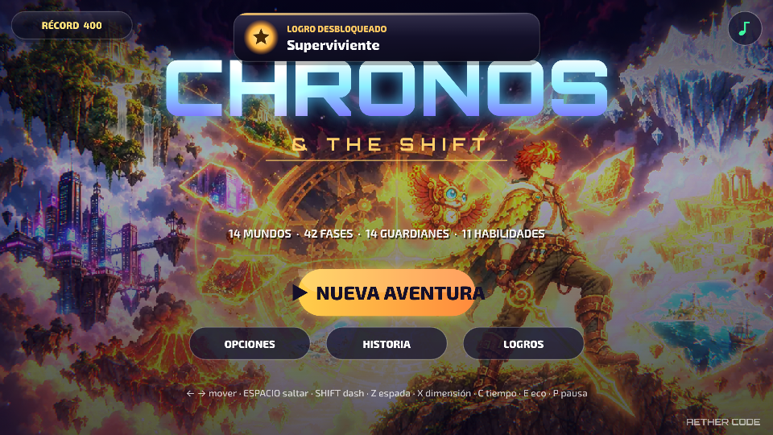

# Chronos & The Shift

Juego de plataformas 2D **dark fantasy** de **Aether Code**, creado por César de los Santos Rivera.

Kael y su búho mecánico Tic recorren **14 mundos**, **42 fases** y **14 guardianes** para recomponer el Reloj del Tiempo.

## Jugar

| | |
|---|---|
| 📱 **Descargar el APK para Android** | [Página de descargas](https://github.com/cesardelossantosdr06-hue/chronos-the-shift/releases/latest) → toca `Chronos-The-Shift.apk` |
| 🌐 **Jugar en el navegador** | https://cesardelossantosdr06-hue.github.io/chronos-the-shift/ |

La versión web se puede **instalar como app** desde Chrome (menú ⋮ → *Instalar app*) y funciona sin conexión.

## Qué incluye (v1.7)
- 14 mundos con arte pintado, iluminación dinámica, partículas y criaturas vivas.
- 11 habilidades que se ganan al vencer guardianes, más guardia y parada perfecta.
- Guardianes con segunda fase (**¡FURIA!**) y muerte épica.
- **Cámaras del Desafío** con oleadas de enemigos y recompensas.
- Continuar desde el último punto de control al caer.
- **3 estrellas por fase** (126 en total): superarla, recoger el 80 % de los fragmentos (o vencer al jefe sin caer) y batir el tiempo objetivo.
- **Torre del Tiempo:** modo infinito con pisos generados de todos los mundos, Cámaras del Desafío cada 5 pisos y un guardián cada 10. Guarda tu récord.
- 22 logros con estadísticas.
- 3 dificultades, controles táctiles configurables y modo de rendimiento para teléfonos modestos.
- **9 idiomas:** español, inglés, portugués, francés, alemán, italiano, japonés, coreano y chino. Se elige al abrir el juego por primera vez y se cambia en Opciones.
- Soporte para mando (Xbox, PlayStation y genéricos por Bluetooth), con vibración y menús navegables.
- Botón *atrás* de Android, pausa automática y guardado en segundo plano.

## Cómo funciona este repositorio
- `src/`: código del juego por módulos y arte empaquetado. `python3 src/build.py` genera `www/index.html`.
- `www/`: el juego listo (un solo archivo), la app web instalable y la [política de privacidad](https://cesardelossantosdr06-hue.github.io/chronos-the-shift/privacidad.html).
- `i18n/`: las traducciones (una frase por número; `es.json` es el original).
- `assets/`: icono y pantalla de carga de la app.
- `store/`: material para Google Play: icono 512, gráfico destacado, capturas y textos.
- Cada vez que cambia el juego, GitHub **compila el APK solo** y lo publica en *Descargas*. También actualiza la versión web.

## Próximos pasos
- [ ] Arte HD para los guardianes clásicos (mundos 1 y 3–7).
- [ ] Arte propio para el Pantano y la Ciudadela.
- [ ] Música y efectos originales.
- [ ] AAB firmado y publicación en Google Play.

© 2026 Aether Code. Todos los derechos reservados.
